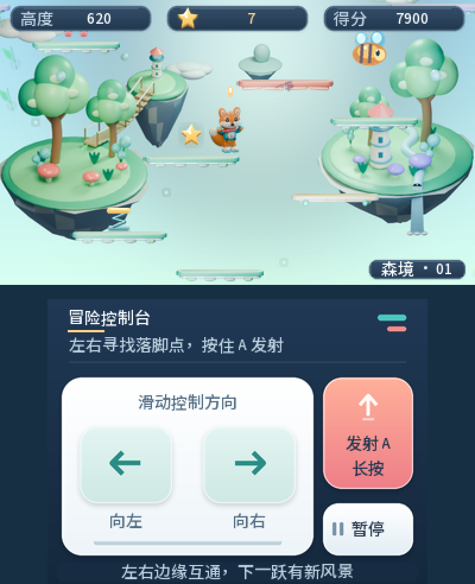

# 涂鸦跃界 · Doodle Hop 3DS

为 Nintendo 3DS / 2DS 编写的原生自制跳跃游戏，版本 **1.3.0**。以《Doodle Jump》的自动弹跳与向上探索玩法为参考，重新实现逻辑、程序生成的平台、原创角色、预渲染三维美术和合成音效。

本项目是独立玩法重制，不是原作源码的直接移植；不包含原作程序、角色贴图、关卡或音乐。



预览使用桌面参考帧缓冲，不是 3DS 实机截图。更多界面见 [screens.png](screens.png)，真实物理的自动试玩见 [motion-preview.gif](motion-preview.gif)。

## 1.3.0 现代卡通冒险

使用 Blender 实际建模与灯光渲染，重新制作狐狸、12 种平台和三套场景：翡翠浮岛、珊瑚天空城、极光晶谷。模型具有柔和圆角、材质高光和体积阴影，绘制完成后转换为小尺寸图片供 3DS 使用。运行时仍为 2D，不增加实时三维渲染负担，也不提供裸眼立体显示。

界面改为深蓝、青绿、珊瑚色的现代卡片；狐狸换上外套、围巾和运动鞋。补充落地光圈与喷气尾光，保留完整 400×240 上屏、原操作热区和存档。

[整套预览](redesign-preview.png) · [三场景](themes-preview.png) · [与 1.2.0 对比](docs/visual-comparison.png) · [设计说明](docs/VISUAL-DESIGN.md)

## 游戏内容

- 自动弹跳、左右穿屏、向上卷屏与随高度变化的程序平台。
- 普通、移动、碎裂和一次性平台，以及弹簧、喷气背包和星星。
- 发射子弹击败怪物，也可以从上方踩落；喷气期间受到保护。
- 上屏全幅 400×240 显示游戏场景，顶部显示高度、星星与得分，适配 3DS 横屏。
- 摇杆／方向键及下屏触控，开始准备、暂停、帮助、失败重试与退出确认。
- 最高高度、最高分、累计局数、累计星星和音效设置保存在独立双槽文件。
- 原创三维预渲染美术：现代狐狸、浮岛植物、天空城、极光晶谷与圆润平台；中文界面与轻量合成音效。

程序生成会保留由普通平台构成的可达路线，特殊平台提供额外选择。可达性和自动导航测试只说明路线可以通过，不能替代真人手感测试。

## 安装

需要已经能够运行自制软件的 3DS / 2DS。

1. 将 `doodle-hop-3ds.cia` 复制到 `SD:/cias/`。
2. 打开 FBI → SD → cias → doodle-hop-3ds.cia → Install CIA。
3. 回到 HOME 菜单，打开“涂鸦跃界”。

也可以把 `.3dsx` 和 `.smdh` 放在 `SD:/3ds/doodle-hop-3ds/`，从 Homebrew Launcher 启动。FTPD 只能传输文件，安装仍需在 FBI 中操作。详细操作与排障见 [INSTALL.md](INSTALL.md)。

Title ID：`000400000F7A3500`。它与本工作区的“小怪商店”“万砖齐发”“霓虹蛇境”不同，不会覆盖这几个应用。这是本地项目标识，并非官方分配的 ID。

## 操作

| 场景 | 操作 | 功能 |
| --- | --- | --- |
| 标题 | A / START / 开始按钮 | 准备新一局 |
| 准备 | A / START / 出发按钮 | 开始自动跳跃 |
| 游戏 | 方向键左右 / 摇杆 | 左右移动，边缘穿屏 |
| 游戏 | 下屏方向区域 | 左侧向左、右侧向右，松开回中 |
| 游戏 | A / 上键 / 下屏射击 | 向上射击，按住可连续发射 |
| 游戏 | START / B / 暂停按钮 | 暂停 |
| 暂停 | A / START / 继续按钮 | 继续当前一局 |
| 暂停 | B | 返回标题 |
| 失败 | A / START / 重试按钮 | 准备新一局 |
| 标题 | Y / 帮助按钮 | 查看玩法说明 |
| 标题 | X / 音效按钮 | 开关音效 |
| 任意场景 | SELECT | 退出确认，A 确认，B 取消 |

其他游戏的存档与本作互不影响。HOME 菜单、合盖和恢复会暂停当前游戏；恢复后需松开先前按住的输入再继续。

## 编译

依赖 devkitPro 的 devkitARM、libctru 和 3DS tools。安装渠道见 [devkitPro 文档](https://devkitpro.org/wiki/Getting_Started)。本项目不需要原游戏文件或联网。

```sh
export DEVKITPRO=/opt/devkitpro
./build.sh
```

生成 CIA 还需要 makerom **0.18.4** 与 bannertool。脚本会拒绝存在标题版本编码问题的 makerom 0.19.0。

```sh
export MAKEROM=/absolute/path/to/makerom
export BANNERTOOL=/absolute/path/to/bannertool
./build-cia.sh
```

使用旧 3DS 64 MB / 268 MHz 应用模式，不依赖 New 3DS 专属功能。屏幕使用 2D 输出。未剥离的 `.elf` 和 `.map` 保留用于定位对应版本的崩溃，不是安装文件。

游戏所需生成资源已包含在项目中：`include/sprite_data.hpp`、`include/background_data.hpp` 和 `include/font_data.hpp`；可审阅的原始尺寸 PNG 位于 `art/generated/`。修改中文文本或已包含的图片后，用 Python 3、Pillow 和 Noto Sans SC 重新生成：

```sh
python3 packaging/generate-assets.py /absolute/path/to/NotoSansSC.ttf
python3 packaging/generate-font.py /absolute/path/to/NotoSansSC.ttf
```

重新建模/渲染三维美术需要 **Python 3.11、bpy 4.5.3 和 Pillow 13.0.0**。仅编译游戏不需要安装 Blender；源码包已经附带渲染后的 PNG 和头文件。

```sh
python3.11 -m venv .venv-art
.venv-art/bin/python -m pip install -r packaging/requirements-art.txt
.venv-art/bin/python packaging/render-modern-3d.py --only all --samples 32
.venv-art/bin/python packaging/generate-assets.py /absolute/path/to/NotoSansSC.ttf
```

三维模型、材质、灯光和相机由 `packaging/render-modern-3d.py` 完整定义；`packaging/modern_ui.py` 生成现代界面；资源整合器生成 `packaging/ASSET-MANIFEST.json` 记录图片尺寸、哈希与像素开销。

## 检查与打包

```sh
./check.sh
export CTRTOOL=/absolute/path/to/ctrtool
python3 packaging/verify-cia.py --output packaging/VERIFIED-BUILD.json
python3 packaging/package-release.py
```

检查使用 C++17 与 AddressSanitizer / UndefinedBehaviorSanitizer，覆盖真实游戏逻辑、输入、存档、音频及主循环的系统服务替身、渲染缓冲边界。CIA 检查比对 ELF 的代码段、资源哈希、权限、Title ID 和版本。

发行脚本生成：

- `dist/doodle-hop-3ds-install.zip`：按 SD 卡路径组织的 CIA / 3DSX / SMDH、说明和验证记录。
- `dist/doodle-hop-3ds-project.zip`：源码、生成资源、构建脚本、测试与说明。
- `dist/SHA256SUMS`：两个 ZIP 的校验和，ZIP 内另有逐文件校验和。

实际测试结果与边界见 [docs/VALIDATION.md](docs/VALIDATION.md)。电脑测试和包体校验不代表已经在实体 3DS 启动或测量帧率。

## 源码结构

| 文件 | 内容 |
| --- | --- |
| `source/game.cpp` | 跳跃物理、扫掠落脚、生成、道具、怪物、分数 |
| `source/render.cpp` | 全幅世界投影、现代卡片界面、背景与动画绘制 |
| `source/controls.cpp` | 摇杆、按键、触控与菜单逻辑 |
| `source/main.cpp` | libctru 生命周期、固定步进、暂停与存档时机 |
| `source/save.cpp` | 独立双槽存档与损坏恢复 |
| `source/audio.cpp` | PCM 合成、NDSP 生命周期与无声回退 |
| `packaging/` | 素材生成、CIA 配置、验证与发行打包 |
| `tests/` | 逻辑、平台、渲染检查及实际代码的预览生成 |

代码与原创资源使用 **GPL-3.0-or-later**，字体和运行库按各自许可证分发，见 [THIRD_PARTY.md](THIRD_PARTY.md)。玩法参考来自 [Lima Sky 发布的 Doodle Jump 产品说明](https://apps.apple.com/us/app/doodle-jump/id307727765)。本作未实现其全部道具、场景、联网排行榜或成就。
